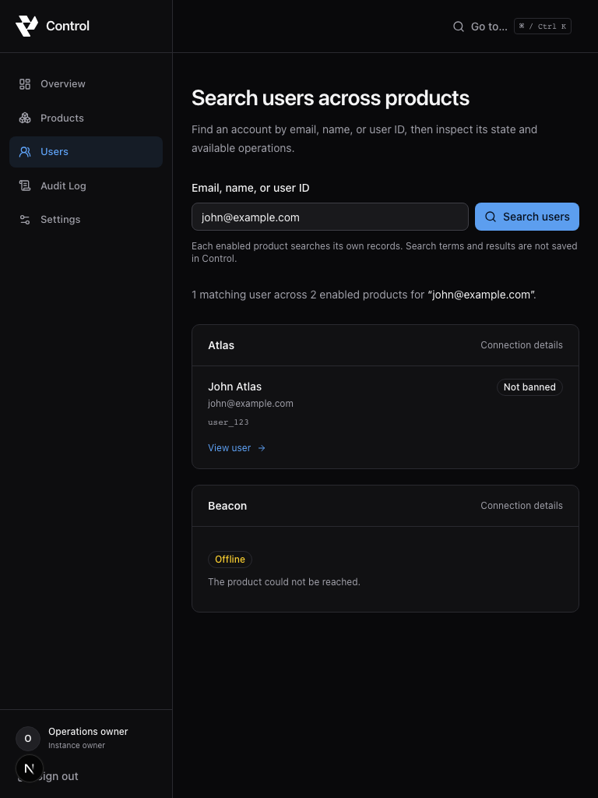
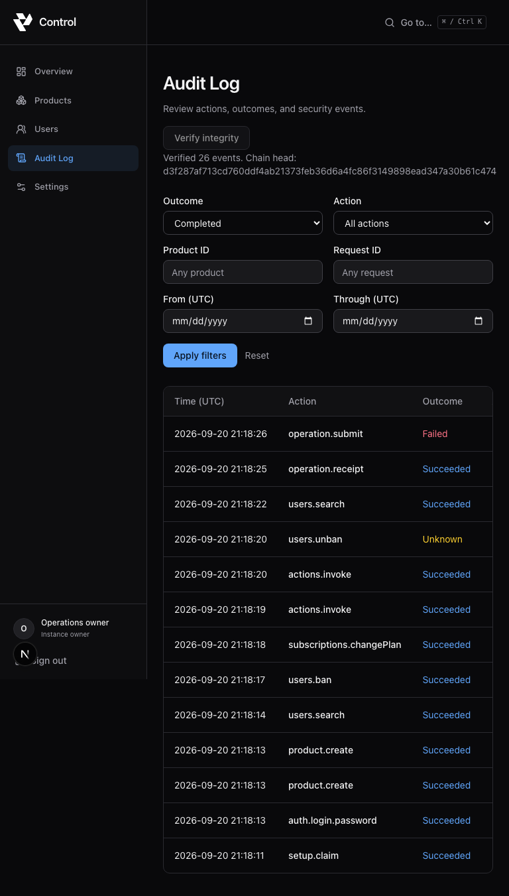

# Yanvah Control

A private, self-hosted command center for SaaS administration: owner authentication, an encrypted product registry, live cross-product user search, confirmed standard/custom operations through the real `@yanvah/control` SDK, and a tamper-evident audit log. Production container packaging, maintenance tools, and deployment guides are included. This checkout may precede the first published application image; verify a release before relying on a registry tag.

Requires Node.js **22.14 or newer** and npm. The lockfile pins the independently published `@yanvah/control` **0.2.1** package.

## Self-host with Docker

From this repository:

```bash
npm ci
npm run setup:production -- --production --url https://control.example.com
docker compose build
docker compose up -d
```

Replace the hostname with your final HTTPS origin and configure a host TLS proxy to `127.0.0.1:3000`. Read the generated setup token privately from `.env.production`, claim `/setup`, then remove the token line and recreate the service. Keep the authentication/encryption keys and persistent `/data` volume. The image runs as a non-root user with a read-only root filesystem; runtime secrets are not part of the build.

Follow the complete [installation guide](docs/INSTALLATION.md), [Tailscale/reverse-proxy/Cloudflare Access guide](docs/DEPLOYMENT.md), and [backup, restore, and upgrade procedure](docs/BACKUP-UPGRADE.md). Maintainers should follow the [image release procedure](docs/RELEASING.md). See [troubleshooting](docs/TROUBLESHOOTING.md) for setup, networking, integrity, and restore failures.

## Local development

```bash
npm install
npm run dev:setup -- --local
npm run db:migrate
npm run dev
```

Normal installs, CI, and containers use the exact SDK version in `package-lock.json`. To test matching local SDK changes, build the sibling SDK and run `npm run sdk:link`; an optional path may follow `--`. The command replaces only the matching installed SDK package with a local link and never modifies SDK source. Run `npm ci` to restore the published package before release validation.

Open <http://localhost:3000/setup>. Read `CONTROL_SETUP_TOKEN` from the generated `.env.local` and create your owner account with a password of 12–128 characters. Setup signs you in and opens Settings, where you can enroll a passkey. Use `localhost` consistently: cookies and passkeys are bound to the configured origin.

The setup tool creates only local configuration, with three independent random secrets and file mode `0600`. It requires `--local`, refuses any explicit non-development `NODE_ENV`, never overwrites configuration, and never seeds an owner or a default password. A fresh database has no owner. Alternatively, copy `.env.example` to `.env.local` and fill in the values yourself.

After claiming the instance, remove the `CONTROL_SETUP_TOKEN` line and restart. Retain the authentication secret, encryption key, and database across restarts. The local development database is `.data/control.db`; local configuration, databases, generated builds, and test artifacts are ignored by Git.

## Configuration

| Variable | Requirement |
| --- | --- |
| `CONTROL_URL` | Exact browser origin, with no credentials, subpath, query, or fragment. Production requires HTTPS; local development allows HTTP on loopback only. |
| `CONTROL_AUTH_SECRET` | Independent secret, 32–512 non-whitespace characters. Signs authentication cookies; keep stable. |
| `CONTROL_ENCRYPTION_KEY` | Independent, canonical base64 encoding of exactly 32 random bytes. Encrypts product credentials and authenticates audit history; retain the same key with database backups. |
| `CONTROL_SETUP_TOKEN` | Independent secret, 32–512 non-whitespace characters. Required until the first owner exists; remove the variable after setup. |
| `DATABASE_PATH` | Defaults to `/data/control.db`. Production requires an absolute path below `/data/`; development may use a relative path. |
| `CONTROL_ALLOW_HTTP_ENDPOINTS` | Strict `true`/`false`, default `false`; prohibited in production. Together with private opt-in, permits SDK HTTP loopback endpoints during local development only. |
| `CONTROL_ALLOW_PRIVATE_ENDPOINTS` | Strict `true`/`false`, default `false`. Allows private-network HTTPS endpoints, including Tailscale addresses. Metadata and link-local destinations remain blocked. |

Generate each secret independently using `openssl rand -base64 32`, or use the explicit `setup:production` tool for a new instance. Never reuse one value across variables. Startup rejects invalid or incomplete security configuration and inconsistent ownership state without printing configuration values. No credentials are generated by production startup. The production build itself requires no runtime secrets or database. Compose loads `.env.production`; local development loads `.env.local`. After editing a container's environment file, recreate it with `docker compose up -d --force-recreate control`.

## Owner access and security

- Setup verifies the token in constant time. Password hashing uses Better Auth. A short SQLite transaction creates the owner, credential account, and completed-setup marker together. A unique database index enforces one owner; triggers prevent reopening setup or registering another user after setup.
- Only the required Better Auth endpoints are exposed. Public signup, password-reset, user-deletion, and unneeded account endpoints are unavailable. There is no email provider or account-recovery service. Keep your password, an enrolled passkey, and a protected backup available.
- Every dashboard page and privileged API checks the database-backed owner session. Session cookies are HTTP-only and SameSite=Lax, and always Secure for HTTPS. HTTP cookies are used only for explicit local development. Cookie session caching is disabled so revocation takes effect on the next request.
- Browser mutations require the exact configured Origin and reject cross-site Fetch Metadata. Authentication responses and session lists omit session tokens. Server-only imports protect database, environment, and authentication modules from client bundles.
- Browser JSON bodies are limited to 16 KiB (64 KiB for authentication), with a ten-second read deadline. Malformed UTF-8, incorrect body lengths, and incomplete uploads are rejected before processing.
- Passkeys require a secure browser context (HTTPS or localhost), a compatible authenticator, and user verification. Their relying-party ID is the `CONTROL_URL` hostname. Changing the hostname can make existing passkeys unusable.
- Sessions expire after seven days and are renewed while active. Adding/removing passkeys and revoking another session require authentication within the last five minutes. Settings offers a sign-in-again flow when required. Sign out invalidates the current database session.
- SQLite-backed, instance-wide rate limits bound setup, login, and security attempts without trusting spoofable proxy IP headers. One owner means a global limit is deliberately simple; repeated hostile attempts can temporarily delay the owner too.
- Responses have a per-request script nonce CSP, frame denial, MIME sniffing protection, no-referrer policy, and no-store caching. HTTPS adds HSTS. Inline styles support the UI primitives; production scripts cannot use `unsafe-inline` or `unsafe-eval`. Development allows eval for Next.js tooling.

No application telemetry is sent. Framework telemetry is disabled by the npm application scripts. The interface uses local system fonts and does not load third-party assets.

## Connected products

1. Expose an endpoint in your SaaS with the SDK server handler. See the inspected [SDK contract](docs/SDK-CONTRACT.md) for exports, credentials, discovery, and error behavior.
2. Open **Products → Add product** and enter a local display name and the full SDK endpoint URL. Names and IDs reported by the SaaS are displayed separately.
3. Supply its existing key ID and secret, or generate a new independent credential. Generated credentials appear once: save them in a secret manager and configure the exact values in the SaaS before continuing. Existing or stored secrets are never returned by product reads.
4. Select **Test connection**. Control sends a signed discovery request from its server, validates the response using the SDK, and records the advertised operations and custom-action metadata. A second SaaS needs only another registration; no Control source changes are required.

Key IDs use 1–128 ASCII letters, digits, underscores, or hyphens. Shared secrets contain 32–1024 UTF-8 bytes and are used literally, without base64 decoding. Control rejects reuse of an existing product secret or an instance configuration secret. There is no saved-secret retrieval endpoint; replace a lost credential on both sides.

Status describes the last explicit test, with its timestamp: **Unknown** before testing or after a configuration change, **Online** after valid discovery, **Offline** when unreachable or timed out, and **Degraded** for authentication, protocol, or policy failures. Failures retain the last validated capabilities with a stale-data notice. No background polling occurs. **Reconnect** runs a fresh discovery attempt without automatic retries. An unavailable product does not block tests or views for other products.

Enable/disable, credential replacement, and removal require confirmation and a sign-in within five minutes. Replacement and removal also require typing the product's name. Disabling, replacing, or removing a product cancels in-flight tests; revision checks prevent late responses from restoring stale state. Disabling retains its configuration; removal deletes the registry entry and credential without modifying SaaS data. The UI reports an unknown outcome if a response is lost and lets you refresh the saved state before repeating a change.

Product credentials use AES-256-GCM with a fresh nonce and authenticated product ID, key ID, and key version. A keyed fingerprint enforces distinct credentials without storing a plaintext secret hash. Browser-facing views omit all encrypted storage fields. Product mutations enforce owner authentication, exact-origin CSRF protection, and durable limits of 30 writes and 30 connection tests per minute. The generated-secret response is the deliberate one-time exception to keeping stored secrets out of browser payloads, and is never cached or persisted in browser storage.

### Endpoint policy

Production requires HTTPS and normal certificate verification. URLs cannot include credentials, queries, or fragments. Redirects are rejected. DNS is validated when saving and on every connection; every returned address must satisfy policy, and the socket is pinned to a validated IP while preserving the original Host and TLS hostname. Loopback, private networks, link-local, metadata, and reserved addresses are blocked by default. Private opt-in never enables known metadata targets. DNS callers have a three-second deadline; OS resolver work may finish later.

Connection attempts have a five-second deadline, a 256 KiB limit on both encoded and decoded response bodies, bounded response headers, and a four-connection instance limit. Remote errors and metadata are untrusted: only safe error codes and SDK-validated text are shown. The browser never contacts a SaaS endpoint directly.

For local SDK fixtures only, set **both** flags below in `.env.local` and restart:

```dotenv
CONTROL_ALLOW_HTTP_ENDPOINTS=true
CONTROL_ALLOW_PRIVATE_ENDPOINTS=true
```

This allows `http://localhost`, `http://127.0.0.1`, or `http://[::1]` with an explicit port/path. HTTP must resolve only to loopback. The SDK does not support arbitrary private HTTP destinations. Loopback access is unavailable in production, even with private opt-in. Use HTTPS for private production SaaS endpoints.

## Users and operations

From a connected product's detail page, choose **Create user** when its v2 SDK handler advertises `users.create`. Enter an email and optional name, review the selected product and possible invitation effects, then confirm. The SaaS creates and owns the account. Control shows the returned user on confirmed success; an already existing email is a definite failure. If the response is lost, Control records an unknown outcome and does not retry. Check the receipt and search the product before starting a new attempt. Protocol v1 products continue to work for their existing operations and never show creation.

Open **Users**, search by email, name, or ID, and choose the account in the intended product. Each enabled SaaS handles the query itself. Control discovers current capabilities and returns up to 20 matches per product; a full page of matches is labeled so you can refine the query. Disabled products are excluded. Results distinguish no match, offline, unauthorized, unsupported, failed, and canceled states. One unavailable product leaves other results usable.

Submitting another search cancels the previous one. A per-tab search sequence prevents late responses from replacing newer results. Remote work uses four shared operation slots with a bounded queue; each individual SDK call retains the five-second deadline, response limits, and endpoint protections from Phase 2. Search/detail requests share a durable limit of 60 per minute; mutation attempts have a separate limit of 30 per minute. Searches and remote user/subscription records are never saved as a local directory.

User details show only fields supported by SDK 0.2.1: identity, optional email/name/ban/creation data, and subscription ID, plan ID, status, and optional period end. Missing fields are explicitly not reported. User and subscription lookups can fail independently. Supported controls appear from fresh capability discovery: ban, unban, revoke sessions, change plan, and advertised custom actions. Product-only actions are also available from **Products → Product actions**, including products without user search. Enter a plan ID recognized by the SaaS; the current SDK does not advertise a plan catalog.

Custom actions appear without a Control code change. The SDK exposes action IDs, labels, descriptions, and risk levels, but **does not publish field schemas**. Control therefore offers a bounded JSON parameter editor, validates the SDK's safe JSON/input schema, and lets the SaaS validate its private field schema before executing. JSON results are validated, treated as text, and displayed with a bounded preview. No remote HTML, scripts, links, or functions are executed by the browser. The product's action documentation defines parameters and scope; the open user record does not automatically scope a custom action.

Every operation requires a sign-in within five minutes and an explicit confirmation showing the product, target, operation, parameters, and consequences. Banning requires typing the user ID; dangerous custom actions require typing the product name. Control re-discovers capabilities before dispatch and rejects a changed capability snapshot, an unsupported operation, or an unadvertised action. The owner identity is included through the SDK's signed actor field.

Operations are never automatically retried. A confirmed success refreshes remote state. A validated rejection is shown as failed. A timeout, connection loss, malformed result, or handler exception after dispatch is **unknown**, since the SaaS may already have changed its state. The UI keeps that distinction, offers **Check recorded outcome**, and requires a deliberate remote refresh before considering another operation. Refreshing does not itself resolve an unknown outcome, and a new confirmation creates a new attempt.

Each attempt has a durable ID. Reusing it with the same request returns its recorded state without dispatching again, including across restarts; different parameters under the same ID are rejected. Append-only `operation_events` record requested and terminal outcomes, owner/product IDs, a keyed target reference, SDK request ID when available, safe error code, duration, and a keyed input fingerprint. They retain neither parameters nor remote outputs. A process interrupted before recording completion leaves an unknown outcome and never resumes the mutation. **Check recorded outcome** reads the receipt, not the SaaS; successful custom output is not recoverable from a receipt.

## Audit and security events

Open **Audit Log** to review setup, password/passkey login, sign-out, passkey challenges/enrollment/removal, session revocation, product changes/tests, searches, and remote operations. Rejected mutation requests are recorded too. Overview shows recent activity and links to failed or unknown outcomes. Routine dashboard reads, health checks, and session refreshes do not create audit events.

The default view shows completed requests. Filter by outcome, action, product ID, Control request ID, or inclusive UTC date range; **All** includes requested events. Pages contain at most 50 records with stable cursor pagination. Open an action for its requested/terminal sequence, owner/product/attempt IDs, target reference, safe result code, duration, timestamps, SDK request ID when available, and integrity hashes. The read API also supports an `actorId` filter. Removed products retain their historical IDs.

Every audited HTTP request receives a server-generated `X-Request-ID`; client-supplied correlation headers are ignored. The Control request ID, mutation attempt ID, and SDK request ID have distinct roles and are connected in the event detail. A repeated remote attempt returns its existing receipt and records an `operation.receipt` event with `duplicate: true`, without dispatching again.

Intent is persisted before privileged work. Every request ends with **succeeded**, **failed**, or **unknown**; unresolved intent becomes unknown with `PROCESS_INTERRUPTED` at startup. An audit write failure blocks work that has not begun and returns `AUDIT_UNAVAILABLE`. If work has already begun, its outcome may be unknown: inspect the affected state before trying again. A successful receipt lookup or search means the read completed, not that every connected product succeeded; remote mutation results have their own audit sequence.

Audit metadata is reconstructed from a narrow allowlist. No passwords, setup tokens, cookies, auth headers, product credentials, raw errors, input parameters, search terms, or remote responses are stored. Arbitrary remote user/action IDs and session/passkey IDs use deterministic keyed references so they cannot smuggle sensitive text into the history. Matching references identify matching raw IDs; use the product ID and target type for context. Phase 3 receipts predating this change retain their original target IDs; they are never rewritten.

SQLite triggers reject audit updates/deletes, and every event has a sequence number and HMAC-SHA-256 hash incorporating the previous hash and its fields. Hashing and target references use separate domain labels with the stable `CONTROL_ENCRYPTION_KEY`; no additional secret is required. Startup verifies the complete chain before serving traffic. **Verify integrity** rechecks it and displays its current head; the verification API is limited to five requests per minute and history APIs to 60. Regular appends verify the last event. Save the head and event count outside the instance if you need a checkpoint. The chain cannot detect deletion of its tail or restoration of an older valid database by itself, and it cannot protect against a host administrator who possesses the encryption key. See the [threat model](docs/THREAT-MODEL.md) and [security policy](SECURITY.md).

Application security events are also emitted to stdout as JSON with the `control.security` event name, timestamp, severity, request ID, allowlisted action/outcome/code, duration, and safe metadata. The logger never serializes request bodies, headers, URLs, or exception objects. Configure retention and access controls for collected logs, including framework/reverse-proxy logs outside this logger. Audit history has no delete/retention API; monitor database and log disk usage.

## Database and runtime

Drizzle migrations live in `src/db/migrations/` and are applied at Node server startup. `npm run db:migrate` also applies them explicitly and can be rerun safely. The container entrypoint runs the compiled application startup checks before opening its HTTP listener; invalid configuration, migration history, ownership state, or audit integrity stops boot. SQLite uses WAL, foreign keys, a busy timeout, and mode `0600` for the database. Keep its directory private to the service account; `/data` must be writable by that account in production. Run a single application instance against the database.

The schema contains Better Auth/passkey tables, the permanent ownership marker, attempt buckets, the product registry with encrypted credentials and capability metadata, append-only remote-operation receipts, and the chained audit history. It never stores remote user directories. Migration `0002_product_registry` extends the authentication schema; `0003_operation_receipts` adds operation receipts; `0004_audit_trail` adds audit events and their append-only triggers. On the first Phase 4 startup, existing operation receipts are imported once with `imported: true`, preserving original timestamps and sanitizing target references and metadata. Incomplete receipts become unknown. Historical authentication and registry events cannot be reconstructed. Receipts and audit events remain after removing a product and must be retained to preserve duplicate-attempt protection and chain integrity. Do not use schema-push commands in production or edit migration history after applying it.

```bash
npm run db:generate  # generate a migration after a deliberate schema change
npm run db:migrate  # apply committed migrations
npm run db:studio   # local development database inspection, loopback only
```

Before changing migrations or runtime versions, stop the application and create a verified SQLite snapshot using the [maintenance procedure](docs/BACKUP-UPGRADE.md). Retain its matching authentication/encryption secrets and image version separately, and copy the snapshot to protected off-host storage. Restore only into a fresh volume, verify startup and audit integrity, then accept traffic. Changing or losing the encryption key makes stored product credentials unusable and audit verification fail; key rotation tooling is not included.

For a production-mode process, supply HTTPS configuration and a writable `/data` directory through the deployment environment, then run:

```bash
npm run build
npm run start
```

The source-checkout server binds to `127.0.0.1` by default for a local TLS reverse proxy. The standalone container listens on its container interface; Compose publishes it only on host loopback. Serve the exact `CONTROL_URL` through the trusted proxy. The application does not trust forwarded headers to establish its public origin. Use the [versioned migration and backup policy](docs/BACKUP-UPGRADE.md) for production maintenance; never point an older image at a newer migrated database.

## Health

`GET /api/health/live` reports process liveness. `GET /api/health/ready` also queries the migrated database. Successful responses are exactly `{"status":"ok"}`; unavailable readiness returns `503` with `{"status":"unavailable"}`. A reachable, migrated but unclaimed instance is ready. Neither endpoint reports versions, paths, environment values, users, or products.

## Validation

```bash
npm run lint
npm run typecheck
npm test
npm run test:release
npx playwright install chromium
npm run test:e2e
npm run build
npm run db:generate
npm audit
```

Release validation must begin with `npm ci` so it exercises the published SDK pinned by the lockfile. Browser tests use a separate `.next/test` build directory, isolated from the developer server. Keep browser tests and production builds sequential, since production build cleanup can affect the surrounding `.next` tree. Browser tests own localhost servers and disposable `.test-data` databases, generate fresh credentials, use Chromium's virtual authenticator for real WebAuthn enrollment/login, and restart the server to verify persistence. Local SaaS fixtures use the actual SDK handler, signing, replay validation, and HTTP response parsing. The browser scenarios verify authentication/security audit sequences, different capabilities, isolated mutations, dynamic actions, lost responses, partial results, duplicate protection, and correlated/redacted audit details with integrity verification after restart. They do not alter the development database. Packaging changes additionally require `docker build -t yanvah-control:local .` and `npm run test:container -- --image yanvah-control:local`; see [CONTRIBUTING.md](CONTRIBUTING.md).

`npm run lint` includes formatting checks. Use `npm run format` to format source, tests, and configuration with the pinned Prettier version; migration files and generated artifacts are excluded.

Tests cover environment rejection, setup-token enforcement, one-owner races and closure, real authentication, session enforcement/revocation, CSRF, recent authentication, safe health responses, rate limits, passkeys, encryption/tamper rejection, SSRF/DNS rebinding, redirects, compressed response limits, cancellation, capability validation, credential isolation, stale-write prevention, independent failures, user search, supported-operation enforcement, schema validation, append-only/redacted receipts and audit events, filtered pagination, legacy receipt import, chain tampering, audit storage/completion failure, duplicate attempts, unknown outcomes, and persistence. Browser artifacts can contain test-only sensitive data and are ignored by Git.

## Screenshots

These are real browser captures from the stable interface using disposable SDK fixtures and synthetic accounts in development mode.





## Implementation notes

Next.js App Router and React render pages and initial user details on the server; client components handle cancellable search, explicit refreshes, forms, confirmations, keyboard navigation, and the TanStack product and audit tables. Tailwind and shadcn/ui Radix primitives provide the dark interface. Lucide provides icons. Zod validates input, Better Auth owns authentication/WebAuthn, and Drizzle with `better-sqlite3` owns persistence. Server-only SDK calls use a restricted native Node HTTP/HTTPS transport; signing and protocol validation remain entirely in the SDK. Phases 3–4 add no dependencies: native AbortController and React state handle cancellation and explicit refreshes. SDK public schemas validate the shared input/response models; credentials, SDK clients, database access, and cryptography stay server-only.

Dependencies are pinned in `package-lock.json`. The Phase 4 review added no packages and `npm audit` reported zero known vulnerabilities across runtime and development dependencies on 2026-09-20. Re-run the audit as advisories and dependencies change. ESLint 9 is the compatible version for the installed Next.js lint plugins. An override upgrades the esbuild dependency of Drizzle Kit's legacy loader to a patched 0.25 release; migration generation is checked with that override. See the [Next.js CSP guidance](https://nextjs.org/docs/app/guides/content-security-policy), [Better Auth documentation](https://www.better-auth.com/docs), and [shadcn/ui documentation](https://ui.shadcn.com/docs) for the underlying libraries.

Licensed under [Apache-2.0](LICENSE). See [contribution guidance](CONTRIBUTING.md), [Code of Conduct](CODE_OF_CONDUCT.md), [changelog](CHANGELOG.md), and the [security disclosure policy](SECURITY.md). Preserve third-party license notices when redistributing; the software license does not grant rights to the Yanvah trademarks.
